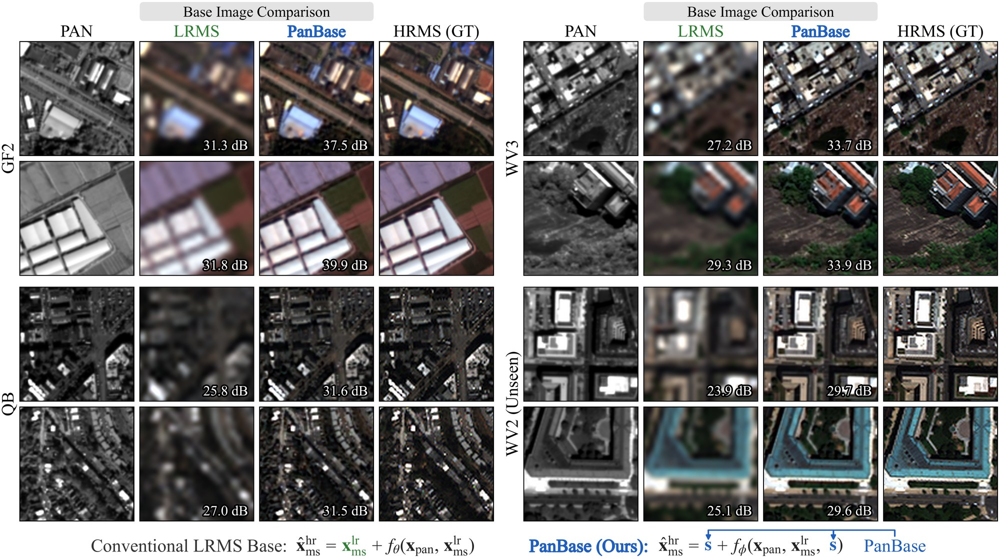
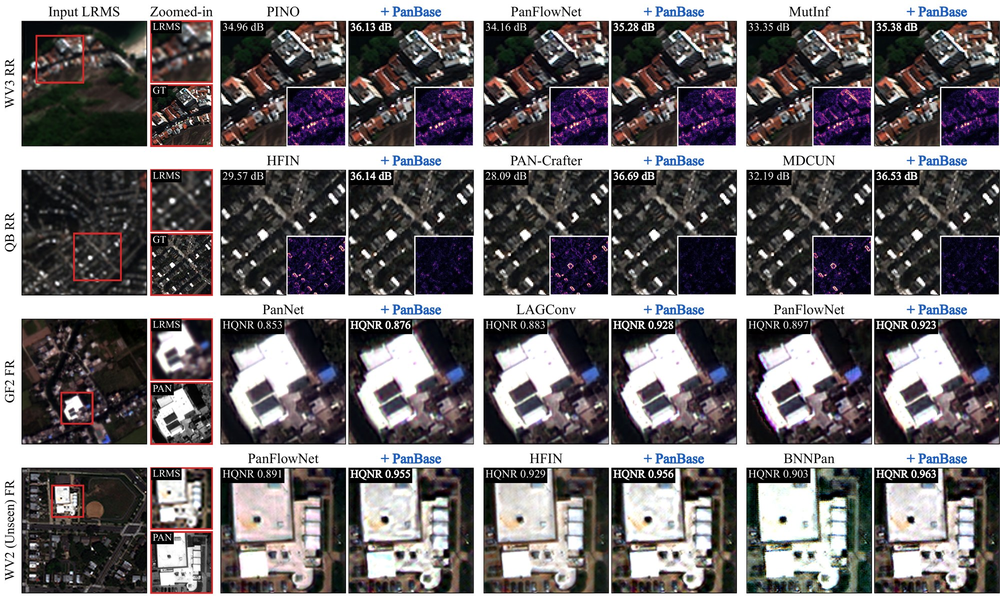
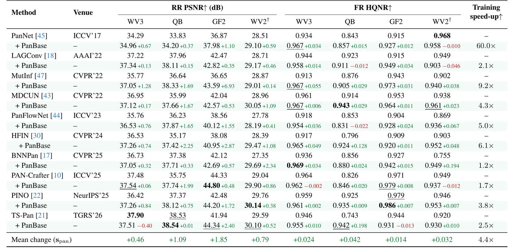
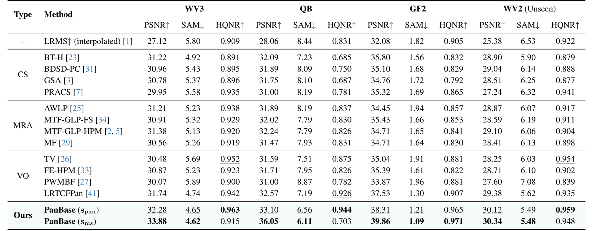
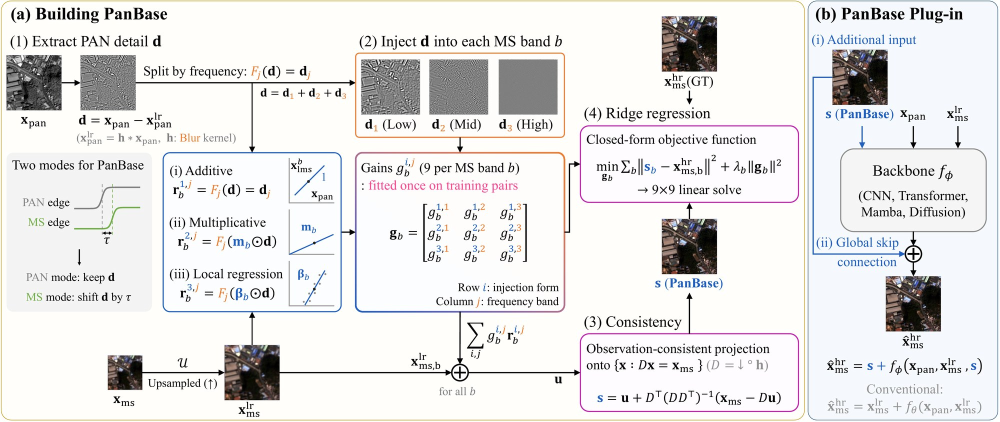

<p align="center">
  <picture>
    <source media="(prefers-color-scheme: dark)" srcset="assets/logo_dark.svg">
    
  </picture>
</p>

<div align="center">
<h2>Change the Base, Change the Game: Rethinking Pan-sharpening</h2>

<div>
    <a href='https://jeonghyeokdo.github.io/' target='_blank'>Jeonghyeok Do</a><sup>*</sup>&nbsp;&nbsp;&nbsp;&nbsp;
    <a href='https://geunhyukyouk.github.io/' target='_blank'>Geunhyuk Youk</a><sup>*</sup>&nbsp;&nbsp;&nbsp;&nbsp;
    <a href='https://www.viclab.kaist.ac.kr/' target='_blank'>Munchurl Kim</a><sup>†</sup>
</div>
<div>
    Korea Advanced Institute of Science and Technology (KAIST), South Korea
</div>
<div>
    <sup>*</sup>Equal contribution&nbsp;&nbsp;&nbsp;&nbsp;<sup>†</sup>Corresponding author
</div>

<div>
    <h4 align="center">
        <a href="https://kaist-viclab.github.io/PanBase_site/" target='_blank'>
        
        </a>
        <!-- ARXIV_BADGE_START --><!-- ARXIV_BADGE_END -->
        <a href="https://huggingface.co/JeonghyeokDo/PanBase" target="_blank"></a>
        
    </h4>
</div>
</div>

---

<div align="center">
    <h4>
        This is the official repository of "Change the Base, Change the Game: Rethinking Pan-sharpening".
    </h4>
</div>

## 📧 News
- **Nov 2026:** The code, the PanBase coefficients and the 129 checkpoints of the paper's 15 backbones are released.
- **Nov 2026:** The [project page](https://kaist-viclab.github.io/PanBase_site/) is online.

## 📖 Abstract
Many pan-sharpening (PS) networks reconstruct high-resolution multispectral (HRMS) images by adding learned residuals to 4×-interpolated low-resolution multispectral (LRMS) inputs, incorporating panchromatic (PAN) detail only through these residual corrections. This raises a simple question: *Why start with a blurry base when sharp spatial detail is already available?* We propose **PanBase**, a sharper multispectral starting point designed for more effective residual learning. Guided by physical sensor characteristics, PanBase combines PAN spatial detail with LRMS spectral information while enforcing consistency with the LRMS observations under sensor-specific blur. We construct this base without neural network training, estimating only nine coefficients per spectral band through closed-form calibration. Our PanBase can be easily integrated into existing backbones with a global residual skip through two simple changes: (i) replacing the skip base with PanBase and (ii) concatenating it as an additional input. Using each backbone's original training recipe and matched training budgets, PanBase improves most reduced- and full-resolution metrics on WorldView-3, QuickBird, and GaoFen-2, while achieving 4.4× faster training convergence on average. In zero-shot evaluation on WorldView-2, standalone PanBase achieves competitive reconstruction without target-sensor fitting or neural refinement.

## 📊 Results
Across ten backbones and four sensors, PanBase improves RR PSNR in 39 of 40 matched comparisons, by up to 6.93 dB, and reaches each original backbone's best score 4.4× faster on average. On its own, without a network, it outperforms all twelve classical methods compared.

### Why Start with a Blurry Base?
The interpolated LRMS (the conventional base) and PanBase against the HRMS ground truth, before any neural refinement. Unseen WV2 reuses the coefficients calibrated on WV3.

<div align="center">
    
</div>

### Qualitative Comparison
Each pair compares an original backbone with its PanBase version: WV3 and QB at reduced resolution (PSNR, error insets), GF2 and unseen WV2 at full resolution (HQNR).

<div align="center">
    
</div>

### Quantitative Comparison
PanBase as a plug-in for ten backbones, under each backbone's training recipe and a matched budget. WV2† uses WV3-trained models without fine-tuning.

<div align="center">
    
</div>
<br>

Standalone PanBase against classical pan-sharpening; no method uses a neural network.

<div align="center">
    
</div>

**Please visit our [project page](https://kaist-viclab.github.io/PanBase_site/) for the interactive gallery and more results.**

## 🖼️ Method Overview

<div align="center">
    
</div>

Most pan-sharpening networks predict a residual on top of the interpolated low-resolution MS image
(`x̂ = x_ms↑ + f_θ(x_pan, x_ms)`). **PanBase** replaces that blurry starting point with a calibrated,
observation-consistent physical estimate **s**, computed without any network in under a second per 256 × 256 image on a
CPU, and feeds it to the network both as the global residual base and as an extra input:

    x̂ = s + f_φ(x_pan, x_ms, s)

PanBase comes in two geometries: **s_pan** (detail aligned to the PAN) and **s_ms** (detail aligned to the MS through an
input-estimated translation). This repository releases:

1. **PanBase itself** (`src/panbase/`): the base estimator (detail forms × frequency bands, projection onto the
   LRMS-consistent set), coefficient fitting for a new sensor, and the fitted coefficients (on Hugging Face).
2. **The 15 backbones of the paper's plug-in tables**, each as the original model and with PanBase s_pan / s_ms:
   our wiring code (`lib/`), training (`train_pancoll.py`), inference (`scripts/infer.py`), one config per checkpoint
   (`configs/cells/`), and 129 trained checkpoints (Hugging Face).
3. **The 12 classical methods** of the paper's comparison (`src/panbase/classical/`, `scripts/classical.py`).
4. **The evaluation code** of the paper tables (`lib/pancoll.py`, `ps_metrics/fr_metrics.py`).

## ⚙️ Installation

```bash
git clone https://github.com/KAIST-VICLab/PanBase.git && cd PanBase
conda env create -f environment.yml && conda activate panbase       # Python 3.9, PyTorch 2.7.1 + CUDA 12.6
bash scripts/fetch_repos.sh        # upstream backbone code at pinned commits + our patches, and the metric toolbox
bash scripts/build_mamba_ssm.sh    # only for MMMamba (CUDA kernels, see CUDA_OPS.md)
```

The upstream backbone code is **not** part of this repository: `scripts/fetch_repos.sh` clones every repository at the
exact commit we used and applies our (small) patch from `patches/`. Each repository keeps its own licence
([NOTICE.md](NOTICE.md)).

## 📦 Pretrained Models

All weights are in the Hugging Face model repository [`JeonghyeokDo/PanBase`](https://huggingface.co/JeonghyeokDo/PanBase): the PanBase
coefficients (`panbase/`) and 129 checkpoints (`backbones/<Method>/<arm>/<train set>/`, 31.5 GB in total).

```bash
hf download JeonghyeokDo/PanBase --include "panbase/*" --local-dir weights/PanBase                  # PanBase coefficients
hf download JeonghyeokDo/PanBase --include "backbones/PINO/*" --local-dir weights/PanBase           # one backbone, all arms
hf download JeonghyeokDo/PanBase --local-dir weights/PanBase                                        # everything (~31 GB)
```

`hf` is the Hugging Face CLI of huggingface_hub ≥ 0.34 (`environment.yml` installs 0.36.0); with an older huggingface_hub,
run `huggingface-cli download` with the same arguments. [MODEL_ZOO.md](MODEL_ZOO.md) lists every checkpoint with its
table values. Not trained (no checkpoint): BNNPan s_ms WV3; BNNPan s_ms QB; BNNPan s_ms GF2; U-Know-DiffPAN s_ms GF2; MMMamba s_ms QB; MMMamba s_ms GF2.

## ⚡ Inference

PanBase alone (no network):

```bash
python scripts/panbase_standalone.py --dataset wv3 --geometry pan --data-root $PANCOLLECTION_ROOT \
    --coeffs weights/PanBase/panbase --out-dir outputs/panbase/wv3_pan
```

A backbone with a released checkpoint:

```bash
python scripts/make_bases.py --dataset wv3 --split reduced        # s_pan / s_ms arms: PanBase base of each test image
python scripts/infer.py --method PINO --arm s_pan --train-set wv3 --split reduced \
    --weights weights/PanBase --out-dir outputs/PINO/s_pan/wv3
python scripts/infer.py --method PINO --arm s_pan --train-set wv3 --eval-set wv2 --split full \
    --weights weights/PanBase --out-dir outputs/PINO/s_pan/wv2_full                 # zero-shot WorldView-2, FR
```

`--arm` is `original`, `s_pan` or `s_ms`. The script prints the metrics next to the paper's table values.
Stochastic backbones (PanFlowNet, BNNPan, PanDiT, U-Know-DiffPAN) are seeded with `torch.manual_seed(0)` before every
test image and reproduce the table within 0.15 dB PSNR; deterministic ones reproduce it to printed precision.
MSDDN must run on CPU (its GPU output differs by 1–10 dB even with TF32 disabled); HFIN needs TF32 disabled on GPU
(the script does this).

## 🗂️ Data Preparation

PanCollection (WorldView-3, QuickBird, GaoFen-2 and the WorldView-2 test sets): see [docs/DATASETS.md](docs/DATASETS.md).
Point `PANCOLLECTION_ROOT` at it (default: `data/pancollection` inside this repository).

## 🏋️ Training

Every released checkpoint has a config in `configs/cells/<Method>_<arm>_<train set>.json` with the exact command, e.g.

```bash
python scripts/make_bases.py --dataset wv3 --split train,valid,reduced,full      # PanBase arms only
python train_pancoll.py --model PINO-in --dataset wv3 --device cuda:0 --max_hours 48 --eval_every 2000 \
    --skip S_PAN --tag _skipS_PAN --results_dir results_panbase
```

All arms of a backbone use that backbone's published recipe and the same iteration budget; the checkpoint is selected
by validation PSNR.

## 📏 Evaluation

RR (reduced resolution, reference available): PSNR, SSIM, SAM, ERGAS, Q2n (Q4 / Q8), SCC after a 30-pixel border cut.
FR (full resolution): D_λ, D_s and HQNR from the Pansharpening Toolbox (fetched by `scripts/fetch_repos.sh`).
WorldView-2 is evaluated zero-shot with the WorldView-3 models and coefficients.

## 🧪 Classical Methods

```bash
python scripts/classical.py --method all --dataset wv3 --data-root $PANCOLLECTION_ROOT --out-dir outputs/classical
```

The 12 classical methods of the paper's comparison, ported to Python; their third-party code keeps its upstream terms
(see License).

## 📁 Repository Structure

```
PanBase/
├── src/panbase/                # PanBase: base estimator, detail forms, projection, coefficient fitting
│   └── classical/              # the 12 classical methods (third_party/ keeps the upstream terms)
├── lib/                        # backbone registry and wiring (specs/), PanBase plug-in (skipvar.py), data + metrics (pancoll.py)
├── ps_metrics/fr_metrics.py    # FR metrics
├── train_pancoll.py            # trainer for every backbone and arm
├── scripts/
│   ├── fetch_repos.sh          # upstream backbones at pinned commits + our patches
│   ├── make_bases.py           # PanBase bases of PanCollection splits
│   ├── panbase_standalone.py   # PanBase on its own
│   ├── infer.py                # inference with a released checkpoint
│   ├── classical.py            # classical methods
│   └── build_mamba_ssm.sh      # MMMamba CUDA kernels
├── configs/cells/              # one config per released checkpoint
├── patches/                    # our patches to the upstream repositories
├── docs/DATASETS.md            # PanCollection
├── MODEL_ZOO.md                # every checkpoint with its table values and upstream licence
├── LICENSE                     # Apache-2.0, the code
├── LICENSE-WEIGHTS.md          # licences of the weights
├── NOTICE.md                   # third-party notices
├── CUDA_OPS.md                 # CUDA extensions (MMMamba, TS-Pan)
├── environment.yml
└── assets/                     # figures and logo of this README
```

## 📑 Citation
If you find PanBase useful, please consider citing:
```BibTeX
@article{do2026panbase,
  title={Change the Base, Change the Game: Rethinking Pan-sharpening},
  author={Do, Jeonghyeok and Youk, Geunhyuk and Kim, Munchurl},
  journal={arXiv preprint arXiv:XXXX.XXXXX},
  year={2026}
}
```

### Prior work

**[U-Know-DiffPAN](https://github.com/KAIST-VICLab/U-Know-DiffPAN)** ([project page](https://kaist-viclab.github.io/U-Know-DiffPAN-site/)), CVPR 2025: PAN-sharpening with uncertainty-aware knowledge distillation.

```BibTeX
@inproceedings{kim2025uknowdiffpan,
  title={U-Know-DiffPAN: An uncertainty-aware knowledge distillation diffusion framework with details enhancement for PAN-sharpening},
  author={Kim, Sungpyo and Do, Jeonghyeok and Lee, Jaehyup and Kim, Munchurl},
  booktitle={2025 IEEE/CVF Conference on Computer Vision and Pattern Recognition (CVPR)},
  pages={23069--23079},
  year={2025},
  organization={IEEE}
}
```

**[PAN-Crafter](https://github.com/KAIST-VICLab/PAN-Crafter)** ([project page](https://kaist-viclab.github.io/PAN-Crafter_site/)), ICCV 2025: PAN-sharpening with modality-consistent alignment.

```BibTeX
@inproceedings{do2025pancrafter,
  title={PAN-Crafter: Learning modality-consistent alignment for PAN-sharpening},
  author={Do, Jeonghyeok and Kim, Sungpyo and Youk, Geunhyuk and Lee, Jaehyup and Kim, Munchurl},
  booktitle={2025 IEEE/CVF International Conference on Computer Vision (ICCV)},
  pages={4242--4252},
  year={2025},
  organization={IEEE}
}
```

## 📜 License

The code is released under the [Apache License 2.0](LICENSE), with third-party notices in [NOTICE.md](NOTICE.md). The
PanBase coefficients and all checkpoints are licensed under
[CC BY-NC-SA 4.0](https://creativecommons.org/licenses/by-nc-sa/4.0/); each backbone checkpoint also carries the terms
of the upstream repository whose code it was trained with ([LICENSE-WEIGHTS.md](LICENSE-WEIGHTS.md),
[MODEL_ZOO.md](MODEL_ZOO.md)). The classical methods in `src/panbase/classical/third_party/` keep their upstream terms
(HS-Pan-Toolbox methods CC BY-NC-SA 4.0; TV, FE-HPM and PWMBF the Pansharpening Toolbox's, nonprofit use only;
LRTCFPan GPL-3.0), and the FR metrics use the Pansharpening Toolbox ("nonprofit purposes only"). The datasets are not
redistributed; the PanCollection imagery is © Maxar / CRESDA.
